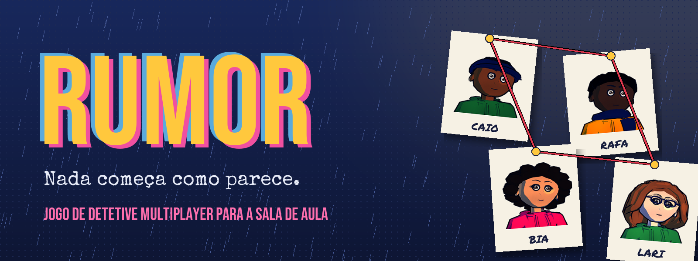
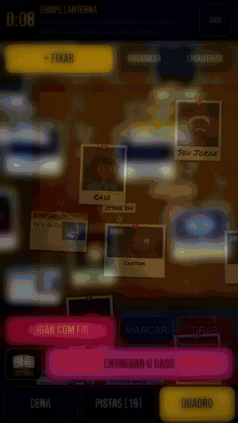
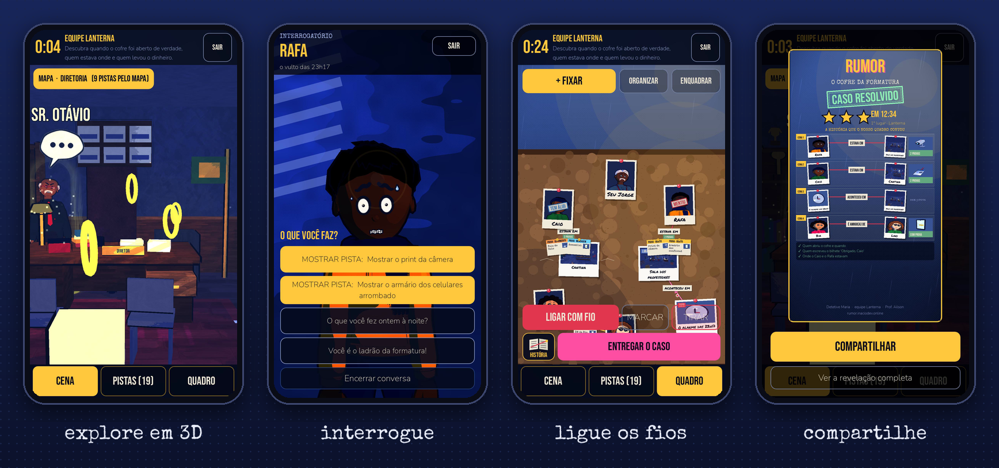
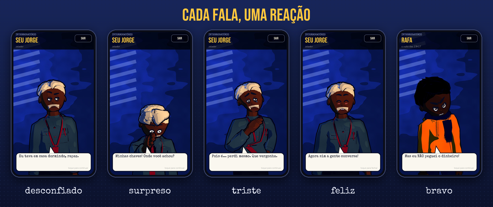
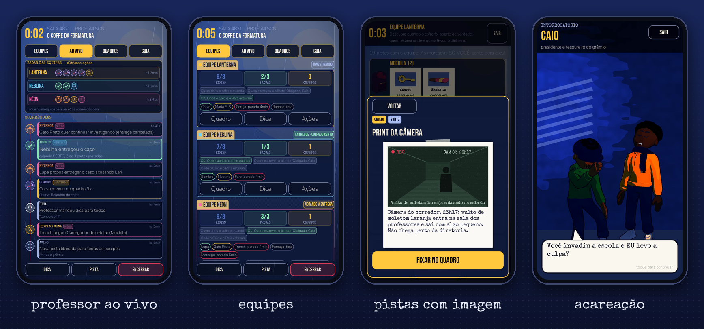

<p align="center">
  
</p>

<p align="center">
  <a href="https://rumor.inaciodev.online"></a>
  
  
  
</p>

> *Um bilhete no cofre vazio. Um vulto de moletom laranja na câmera das 23h17. Oito pessoas, oito versões.*
> *Alguém está mentindo, e a turma inteira tem até o fim da aula para descobrir quem.*

**RUMOR** é um jogo de detetive **multiplayer para a sala de aula**, feito para rodar no navegador do celular de cada aluno. As equipes exploram a escola em **3D**, interrogam personagens que **mudam de expressão** conforme a conversa aperta, mostram provas no momento certo para pegar uma mentira e montam juntas um **quadro de detetive** com fotos, fios vermelhos e pistas presas. O professor acompanha tudo ao vivo do celular ou do projetor.

Visual noir de quadrinho: azul da noite, amarelo de abajur, chuva na janela e uma trilha original tocando no fundo.

<table><tr>
<td width="34%" align="center"><a href="docs/trailer.mp4"></a><br><sub>▶ <a href="docs/trailer.mp4">assistir ao trailer</a></sub></td>
<td width="66%"></td>
</tr></table>

---

## 🕵️ Como se joga

| | |
|---|---|
| **1. Explore** | Cada caso acontece em vários cômodos da escola em 3D (corredor, biblioteca, cantina, sala do diretor...). Arraste para olhar em volta e toque no que brilha: objetos viram pistas da equipe. |
| **2. Interrogue** | Toque num personagem para conversar. Cada fala muda o rosto e o gesto dele. Escolha o que perguntar e **mostre a pista certa** para desmontar uma versão. Pergunta errada fecha a porta por um tempo. Às vezes duas pessoas discutem na sua frente. |
| **3. Ligue os fios** | No quadro compartilhado, a equipe fixa pessoas, lugares e fatos e liga tudo com barbante: *estava em*, *mentiu sobre*, *acobertou*... Cada fio recebe as pistas que o provam. Dá para marcar cartas como **inocente**, **suspeito**, **mentiu** ou **álibi**. |
| **4. Entregue** | Quando a história fecha, a equipe vota a entrega do caso. O objetivo principal é o culpado. Os secundários são as provas de como tudo aconteceu. Quem errar não fica sabendo a resposta. |
| **5. Compartilhe** | A vitória gera um cartão em formato de story com a história que o quadro da equipe contou. |

<p align="center">
  
</p>

### Para o professor
- Cria a sala, escolhe o caso num arquivo de pastas e mostra o código de 4 dígitos no telão.
- Faz a chamada antes de começar (todos tocam em **PRONTO**) e vê quem falta.
- Acompanha **AO VIVO**: radar das equipes, ocorrências com ícones, pistas achadas, provas cumpridas e quem está parado.
- Abre o quadro de qualquer equipe, manda dica, libera pista e encerra a rodada.
- O **guia do caso** traz a solução completa, os objetivos e a história em formato de dossiê.

### Modo solo
Seis casos para jogar sozinho, organizados como pastas de arquivo, com confirmação antes de entregar e a opção de tentar de novo.

---

## 📁 Os casos

12 casos escritos à mão, sem IA gerando história. Todos são verificados por scripts para não ter furo: toda pista existe, toda conversa leva a algum lugar e todo objetivo pode ser provado.

| Multiplayer | Dif. | | Solo | Dif. |
|---|:-:|---|---|:-:|
| O Cofre da Formatura | ★ | | Sai do Time | ★ |
| A Urna | ★ | | O Recado no Muro | ★ |
| A Conta Sem Rosto | ★★ | | A Invasão das 2h03 | ★★ |
| O Gabarito | ★★ | | Três Mil no Vestiário | ★★ |
| A Final no Escuro | ★★★ | | A Armação | ★★★ |
| A Garota que Não Existe | ★★★ | | A Taça do Fundador | ★★★ |

Quanto mais difícil o caso, mais gente mente, mais versões se contradizem e mais objetivos secundários existem. Os casos ficam em `server/cases/*.json`, com o formato descrito em [`docs/formato_caso.md`](docs/formato_caso.md).

---

## ▶️ Rodar o projeto

### Jogar sem instalar nada
Abra **https://rumor.inaciodev.online** no celular ou no PC.

> O servidor gratuito dorme depois de 15 minutos sem uso. Abra o link uns 2 minutos antes da aula para ele acordar.

### Rodar numa rede local (sala sem internet)
Precisa de **Node.js 18+**. O jogo já vem compilado em `server/public/`.

```bash
cd server
npm install
npm start
```

O terminal mostra os endereços:

```
  Neste computador: http://localhost:8080
  Na rede da escola: http://192.168.0.12:8080
```

1. No computador do professor, abra o endereço e toque em **Sou professor**.
2. Os alunos, na mesma rede Wi-Fi, abrem o endereço da rede no celular, digitam o código da sala e o próprio nome.
3. Escolha o caso, monte as equipes e comece.

Celular que apagou a tela volta para a mesma equipe sozinho ao reabrir a página.

### Desenvolver

| O que | Como |
|---|---|
| Abrir o jogo no editor | Godot **4.7.1** (renderizador Compatibility), pasta `game/` |
| Servidor com recarga | `cd server && npm start` (porta em `PORT`, padrão 8080) |
| Testes do servidor | `cd server && npm test` (uma rodada completa por WebSocket) |
| Exportar para web | `GODOT=/caminho/godot bash tools/build_web.sh` (gera `server/public/` comprimido) |
| Validar os casos | `node tools/dev/audit_cases.js` e `node tools/dev/play_probe.js` |
| Sondas de interface | `game/tools_dev/*.tscn` (capturam telas sem servidor, sempre mudas) |

Publicação: cada push na branch `main` vai para o ar sozinho no Render (`render.yaml`).

---

## ⚙️ Especificações

| | |
|---|---|
| **Cliente** | Godot 4.7.1, GDScript, renderizador GL Compatibility, exportação web sem threads |
| **Servidor** | Node.js + [`ws`](https://github.com/websockets/ws), servidor com autoridade sobre o jogo: salas, equipes, quadro compartilhado, votação e conferência da teoria |
| **Tela** | Celular em pé primeiro (720x1280 lógico) e PC deitado com layout próprio |
| **3D** | 12 cômodos e a fachada da escola, com shader toon e contorno, céu pintado, chuva, poeira de luz, figurantes andando e resolução que se ajusta à fluidez |
| **Personagens** | Modelos montados em Blender por script, animações de corpo, rostos com 7 expressões, adultos com barba, bigode e roupa formal |
| **Pistas** | 192 pistas, cada uma com imagem: 58 objetos 3D, bilhete de letras recortadas, quadro de câmera de segurança, comprovante de Pix |
| **Rede** | Reconexão automática, estado retomado pela sessão, ações simultâneas da equipe resolvidas no servidor |
| **Segurança** | Filtro de nomes contra palavrão e gíria (com cuidado para não barrar sobrenomes), resposta escondida de quem errou |
| **Arte e som** | Tudo feito para o jogo: modelos e texturas por código e Blender, ilustrações por IA retrabalhadas, efeitos sintetizados e trilha original |

### Estrutura

```
game/            cliente Godot
  scripts/       telas, quadro, cenas 3D, conversa, rede
  assets/        retratos, lugares, objetos, fontes, áudio
  tools_dev/     sondas e gravação de trailer (fora da exportação)
server/
  src/           salas, validação da teoria, filtro de nomes
  cases/         os 12 casos em JSON
  public/        o jogo exportado para web
tools/           Blender, arte, áudio, geradores de casos, scripts de teste
docs/            formato dos casos e imagens
```

---

<p align="center">
  
</p>

<p align="center">
  Feito por <a href="https://github.com/GabrielInacior">Gabriel Inácio</a> para as aulas do Prof. Ailson.<br>
  <sub>Trilha "Bloodline" original. Nenhum asset pronto de terceiros.</sub>
</p>
